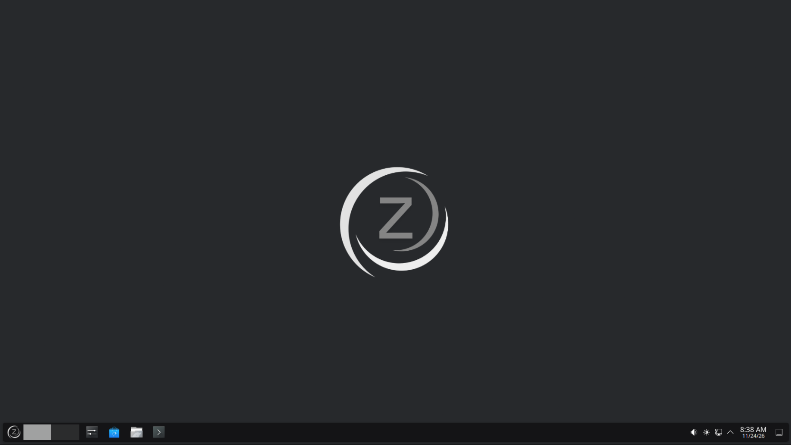

  
  <h1>ZelixOS</h1>
  
An Arch Linux based distribution with a graphical installer, a considered desktop experience, and tools for everyday maintenance.

  

    <a href="https://zelixos.com/">Website</a> ·
    <a href="https://zelixos.com/download/">Download</a> ·
    <a href="https://github.com/ZelixOS/zelixiso#getting-started">Getting started</a> ·
    <a href="https://github.com/ZelixOS/zelixiso/releases/latest">Latest release</a> ·
    <a href="https://www.reddit.com/r/ZelixOS/">Reddit</a>
  

 

## About ZelixOS

ZelixOS combines an Arch Linux base with the Aurora appearance and a set of applications built for the distribution. The installer lets you choose your software, desktop environment, and system settings before installation. The default desktop is KDE Plasma; GNOME, Xfce, Hyprland, Sway, i3, and bspwm are also available.

Zelix applications support English, Turkish, and Spanish.

## Projects

| Project | What it does |
| --- | --- |
| [ZelixOS](https://github.com/ZelixOS/zelixiso) | Installation image, system configuration, and build tools |
| [Zelix Installer](https://github.com/ZelixOS/zelixins) | Graphical installation and system setup |
| [Zelix Hello](https://github.com/ZelixOS/zelix-hello) | Welcome screen, applications, and system tools |
| [Zelix Updater](https://github.com/ZelixOS/zelix-updater) | Graphical package updates |
| [Zelix CLI](https://github.com/ZelixOS/zelix-cli) | Terminal commands for common maintenance tasks |
| [ZelixPen](https://github.com/ZelixOS/zelixpen) | Drawing and screen annotation |
| [ZelixRepo](https://github.com/ZelixOS/zelix-repo) | Package recipes and repository indexes |

## Get started

Download the latest ISO from the [release page](https://github.com/ZelixOS/zelixiso/releases/latest) and follow the [getting started steps](https://github.com/ZelixOS/zelixiso#getting-started). Installation needs an internet connection. The automatic disk layout erases the selected disk, so back up your files and review the disk summary before continuing.

Questions and feedback are welcome on [Reddit](https://www.reddit.com/r/ZelixOS/). For a reproducible problem, please open an issue in the relevant project repository.
